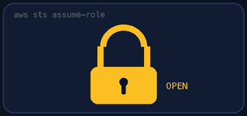
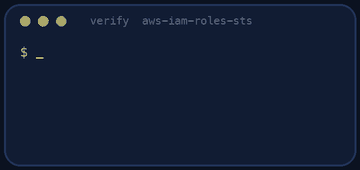
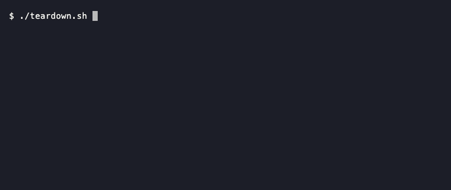

<p align="center"></p>

| | |
|-|-|
| **Time** | 60-75 min |
| **Cost** | free |
| **You need** | An AWS administrator user (the IAM lab), the AWS CLI v2 configured for it, Python 3 and a terminal |

## How this lab works

1. **Fork** this repository to your own GitHub account (button at the top right).
2. Clone **your fork** in your Ubuntu environment (WSL on Windows, your OrbStack machine on Mac).
3. Read the lab below (the same text is in [`LAB.md`](LAB.md)) and follow the mission.
4. Answer the questions in [`SUBMISSION.md`](SUBMISSION.md). Where a question asks for output, paste it in a code block. No screenshots needed.
5. Commit and push. Open the **Actions** tab of your fork (click *I understand my workflows, go ahead and enable them* the first time). The **Lab check** shows what is still missing.
6. When the check is green, **submit the URL of your fork** in the course platform.

> [!NOTE]
> The check only looks at your answers and any files the lab asks you to commit. Your instructor reads your work and may ask you to explain any line.

<p align="center"></p>

## 🎬 The situation

<p align="center"></p>

**Interviewer:** *"Walk me through it. Your lead gave you the Clippy export job, with the words 'there is no documentation, the job just works, find out how'. What did you find?"*

**You (after reading the repository):** *"The job runs as an IAM user. Its access key was generated a year ago, committed in a configuration file, and never rotated. Everyone who ever cloned the repository can read the bucket with the customer list."*

**Interviewer:** *"A scan flagged it this morning. What do you do first, and what do you do second?"*

That is the lab. The first job is to **stop the bleeding**: the key must stop working. The second is to **fix the design**: the export job should never hold a long-lived key at all. It should ask AWS Security Token Service for temporary credentials through a **role**, able to do one thing and expiring in an hour. You answer by doing, and the checker is the second interviewer.

> [!IMPORTANT]
> **Your mission**
> - See, with your own eyes, what the leaked key can do
> - Deactivate it, the way you would in the first ten minutes of an incident
> - Create the role `clippy-export-writer`: a **trust policy** (who may become it) and a **permission policy** (what it may do)
> - Assume it with STS and prove what the temporary credentials can and cannot do
> - Tear everything down and prove it

**Time:** 60-75 min | **Cost:** free | **You need:** an AWS administrator user, the AWS CLI v2 configured for it, Python 3 and a terminal.

<p align="center"></p>

## Part 0 - Set the scene

1. **Fork** this repository, clone it, and create the scene:

```bash
./setup.sh
```

It creates the bucket `clippy-iamlab-<your account id>` (with a private customer list in `private/` and nothing in `exports/`), the IAM user `clippy-export-legacy`, and writes that user's access key to `.legacy-key.env` (gitignored; in the story, this is the file that was committed).

2. Look at the user and its policy in the **IAM console**. What can it do? Which resources does it name?

<p align="center"></p>

## Part 1 - What the leak allows

<p align="center"></p>

Use the leaked key from a shell that does **not** have your own credentials (the subshell below loads only the old key):

```bash
B=clippy-iamlab-$(aws sts get-caller-identity --query Account --output text)
( set -a; . ./.legacy-key.env; set +a
  aws sts get-caller-identity
  aws s3 ls s3://$B/
  aws s3 cp s3://$B/private/customers.txt - )
```

> [!NOTE]
> **Think** `aws sts get-caller-identity` works with any valid credentials and needs no permission. Why is that useful to an attacker, and to you?

<p align="center"></p>

## Part 2 - First answer: stop the bleeding

In an incident the order matters: **cut the access first, investigate second**. Make the leaked key unusable without deleting it (so the evidence stays):

```bash
aws iam list-access-keys --user-name clippy-export-legacy
aws iam update-access-key --user-name clippy-export-legacy --access-key-id <the key id> --status Inactive
```

Run Part 1 again. What do you see now?

> [!NOTE]
> **Think** The key was committed to git a year ago. Deactivating it fixes the *key*. List what else you would do in the first ten minutes (the repository history, CloudTrail, other places the key was copied to). Why is deleting the file in a new commit not enough?

<p align="center"></p>

## Part 3 - Second answer: build the role

Create the role `clippy-export-writer` (console first, then the CLI):

1. **Trust policy**: who is allowed to assume the role. Trust **one** principal: your own identity (the ARN printed by `aws sts get-caller-identity`; for an assumed role or SSO session, the ARN of the *role*, not of the session). `Principal: "*"` would let anyone in the world try.
2. **Maximum session duration**: 1 hour.
3. **Permission policy** (inline): allow **exactly one action**, `s3:PutObject`, on **exactly one resource**: the folder `exports/` of the bucket (`arn:aws:s3:::clippy-iamlab-<id>/exports/*`). No `s3:*`, no `Resource: "*"`, no managed policies.

> [!NOTE]
> **Think** The permission policy and the trust policy are two different documents with two different questions. Say in one sentence what question each answers. If you swapped them by mistake, which error would you get?

Wait ten seconds (IAM is eventually consistent).

<p align="center"></p>

## Part 4 - Become the role

```bash
aws sts assume-role --role-arn arn:aws:iam::<account>:role/clippy-export-writer \
  --role-session-name export-job --duration-seconds 900
```

The answer holds three values: `AccessKeyId`, `SecretAccessKey` and **`SessionToken`**, plus an `Expiration`. Export them (the three variables are `AWS_ACCESS_KEY_ID`, `AWS_SECRET_ACCESS_KEY`, `AWS_SESSION_TOKEN`) in a subshell and run the tests:

```bash
echo "report" | aws s3 cp - s3://$B/exports/report.csv     # should work
echo "x"      | aws s3 cp - s3://$B/private/x.csv           # should be denied
aws s3 cp s3://$B/private/customers.txt -                    # should be denied
aws s3 rm s3://$B/exports/report.csv                         # should be denied: write only
aws s3 ls s3://$B/                                           # should be denied
```

Read each `AccessDenied` message. Notice it says *"no identity-based policy allows the action"*: an **implicit deny**. Everything not allowed is denied.

> [!NOTE]
> **Think** The export job can write but cannot read back, list or delete what it wrote. Is that a bug or a feature? Who could still delete the file?

<p align="center"></p>

## Part 5 - Prove it

<p align="center"></p>

```bash
./verify.sh
```

It reads the real IAM objects, assumes your role **as you** and runs the five tests above. Fix what is red and run it again until it ends with **ALL CHECKS PASSED**.

> [!TIP]
> **Stuck?** `AccessDenied` on `AssumeRole`: your trust policy names the wrong principal. `MalformedPolicyDocument`: a quote or comma in the JSON; use `file://policy.json`. A change does not take effect: wait ten seconds and retry.

<p align="center"></p>

## Level up (optional)

- Add a condition to the trust policy that requires **MFA** (`aws:MultiFactorAuthPresent`) or an **external id**. When do you want each?
- Attach the role to an EC2 instance through an instance profile and call the bucket from the server without any key. Where do the temporary credentials come from? (The next EC2 lab shows the answer.)
- Create a **permissions boundary** that caps what any role created by a developer could ever do.

<!-- teardown:start (generated by labs.py, do not edit) -->
## Tear down (mandatory)

<p align="center"></p>

Resources left behind cost money, keep doors open and pollute the next lab. Removing what you created is part of the job, so it is part of the submission: **you must prove it is gone**.

Do this **last**, after you have pasted your `verify` output into `SUBMISSION.md` (once you tear down, the lab can no longer be verified).

1. Run `./teardown.sh`. It deletes the role, its policies, the bucket and the old access key `clippy-export-legacy`. Then run `./verify-teardown.sh`.

Then run the proof:

```bash
./verify-teardown.sh
```

It prints a list of checks and must end with **TEARDOWN VERIFIED**. If it reports leftovers, remove them and run it again. Paste the full output in your submission.
<!-- teardown:end -->

<!-- submission:start (generated by labs.py, do not edit) -->
## 📬 Submission

Answer the questions in `SUBMISSION.md` in **your fork** (paste output in code blocks where asked), push, then submit the **URL of your fork**.

**Files to commit**

- `notes.md` with your policies and the commands you used (optional)

**Questions to answer**

1. Paste your role's trust policy and its permission policy. Who may assume the role and what may they do? Why is `"Principal": "*"` in a trust policy dangerous?
2. Paste the output of `aws sts assume-role` with the secret values replaced by `...`. What are the three parts of temporary credentials and when do they stop working?
3. Show the commands that prove the role can write under `exports/` and cannot delete, cannot write outside the prefix and cannot list the other bucket. Paste the error messages. How do you read `AccessDenied` for an explicit versus an implicit deny?
4. The old access key was committed to git. List, in order, what you do in the first ten minutes (the key, the repository history, the audit). Why is deleting the file in a new commit not enough?
5. When would you use a role with an external id or MFA condition instead of a plain trust policy? Give one real example.
6. Paste the output of `./verify.sh`. It must end with **ALL CHECKS PASSED**.
7. **Tear down.** Paste the output of `./verify-teardown.sh`. It must end with **TEARDOWN VERIFIED**.
<!-- submission:end -->
